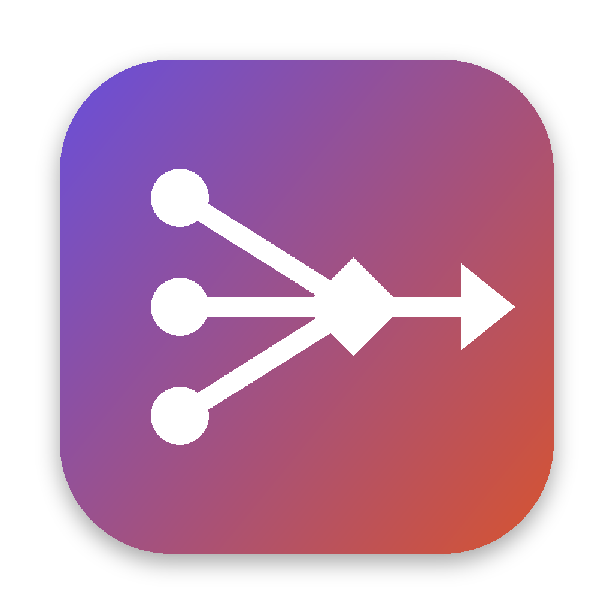

# Personal Harness

[](https://github.com/amitroy257/personalharness/actions/workflows/ci.yml) [](https://github.com/amitroy257/personalharness/actions/workflows/macos.yml) [](https://github.com/amitroy257/personalharness/actions/workflows/windows.yml) [](https://github.com/amitroy257/personalharness/actions/workflows/android.yml)

A personal, **OpenRouter-style** app for **macOS, Windows and Android**. It brings together the **free tiers** of many LLM providers behind:

- **a chat app**, and
- **one local OpenAI-compatible API** (`http://127.0.0.1:4141/v1`) that Cursor, VS Code extensions, scripts and other tools can use.

It also **ranks the models you can actually use** (strongest, most used, hot and personally best) and recommends which one to use. Everything is stored **on your own devices**: inside the App Sandbox on macOS, in your local Windows profile with API keys encrypted by DPAPI on Windows, and in Android's private app storage on phones. If you want your chats and settings on all your devices, optional **end-to-end encrypted sync** goes through a server you run yourself, which can't read your data.

<p align="center"></p>

## Quality & testing

Every push is tested on **Linux, macOS and Windows**. The macOS and Windows jobs install the real app, launch it, and make it attack its own privacy guarantees. Each run's **Summary** tab on GitHub shows a pass/fail table with evidence. Full SQA report: **[docs/TEST_REPORT.md](docs/TEST_REPORT.md)**.

| Area | What is proven | Status |
|---|---|:-:|
| **Data sandboxing (macOS)** | The installed app tries to list your home folder, read `~/Documents` and `~/Desktop`, and write into your home folder. The App Sandbox must deny every attempt, or the build fails. All data stays in its container. | ✅ |
| **Data protection (Windows)** | Keys and token are DPAPI-encrypted on disk (CI decrypts them with Windows' own API to prove it); data stays in the local, non-roaming profile | ✅ |
| **Deleted data is really gone** | After deleting a chat, its text is not recoverable from the raw database, WAL or SHM files | ✅ |
| **Owner-only files** | Data folder `0700`, settings and database files `0600` | ✅ |
| **Keys never leak** | Each provider receives only its own key; your local token and your client's headers are never forwarded; the UI never sees full keys | ✅ |
| **Local API is local** | Unreachable from the network, token required (401), foreign Host rejected (403, anti DNS-rebinding), no CORS | ✅ |
| **No unexpected traffic** | With public data off, the ranking client makes zero requests; optional keys go only to their own service | ✅ |
| **Malicious model output** | Scripts, event handlers, `javascript:` links, tracking pixels and iframes are neutralised (unit tests plus a live browser attack) | ✅ |
| **Routing** | Rate-limit fallback to the same model on another provider, cooldowns, streaming, `auto` presets | ✅ |
| **Installers** | Universal DMG (arm64 + x86_64), NSIS per-user setup + MSI; launch in about 2 s; single instance | ✅ |
| **Dependencies** | `npm audit` 0 vulnerabilities; `cargo audit` 0 vulnerabilities across 540 crates | ✅ |
| **Code quality** | rustfmt, clippy with warnings as errors, TypeScript strict; 42 Rust + 10 UI tests | ✅ |

The review found 5 defects in the shipped code, including one **High**: deleted chats were recoverable from SQLite's write-ahead log. All are fixed with regression tests; see §5 of the report. Known residual risks, the main one being that real-provider behaviour is tested with mocks in CI, are listed in §7.

Run the same privacy checks on your own machine: **Privacy & Settings → Run privacy check**.

## What it does

| | |
|---|---|
| **Free-tier aggregation** | Built in: Groq, Google Gemini, Mistral, Cerebras, GitHub Models, NVIDIA NIM, Cloudflare Workers AI, SambaNova, Hugging Face, Zhipu GLM Flash. You can add any OpenAI-compatible endpoint, such as a local Ollama or LM Studio. |
| **OpenRouter-like routing** | Ask for `auto`, `auto:coding`, `auto:reasoning` or `auto:fast`, an exact `provider/model`, or a bare model name like `llama-3.3-70b`. If a route is rate-limited or down, the request moves to the **same model on another provider**, then to the **next-best model**. Rate-limited routes cool down (it honours `Retry-After`). OpenRouter's `models: [...]` fallback list also works. |
| **Rankings & recommendations** | Views: **Recommended** (General / Coding / Reasoning / Fast), **Strongest**, **Most used**, **Hot**, **My usage**. Each score explains *why*. |
| **Private by design** | macOS: App Sandbox. Windows: local (non-roaming) profile folder, secrets encrypted with DPAPI. Keys and chats never leave the machine; no account, no sync, no telemetry. The local API listens on loopback only and needs a token. |

## Install on macOS (DMG)

Every push builds a universal DMG (Apple Silicon and Intel) on GitHub Actions:

1. Open **Actions → "macOS app (DMG)"**, pick the latest green run, and download the **PersonalHarness-macOS-universal** artifact (a zip containing the `.dmg`). Tagged versions (`v*`) also attach the DMG to a **GitHub Release**.
2. Open the DMG and drag **Personal Harness** to **Applications**.
3. The app is ad-hoc signed, not notarized: there is no paid Apple Developer ID. The first time you open it, macOS will block it. Do one of the following:
   - Right-click the app, choose **Open**, then **Open** again; or
   - go to **System Settings → Privacy & Security** and click **Open Anyway**; or
   - in Terminal, run: `xattr -dr com.apple.quarantine "/Applications/Personal Harness.app"`

Closing the window leaves the app running in the **menu bar**, so the local API stays available. Quit it from the menu-bar icon or with ⌘Q.

## Install on Windows

Every push also builds Windows x64 installers (Windows 10 and 11; also runs on Windows on ARM through emulation):

1. Open **Actions → "Windows app (installer)"**, pick the latest green run, and download **PersonalHarness-Windows-x64**. Tagged versions attach the installers to the **GitHub Release**.
2. Run **`Personal Harness_0.1.0_x64-setup.exe`**. It installs for your user only, with no administrator prompt. An `.msi` is also provided if you prefer it, for example for managed installs.
3. The installer is not code-signed (that needs a paid certificate), so **SmartScreen** may say "Windows protected your PC". Click **More info → Run anyway**.

Closing the window keeps the app running in the **system tray** (near the clock), so the local API stays available. Left-click the tray icon to reopen the window; right-click it for **Quit**. Opening the app again from the Start menu brings back the running instance rather than starting a second copy. The installer adds the Microsoft Edge WebView2 runtime if it is missing (it is preinstalled on Windows 10/11).

## Install on Android

Every push also builds an Android APK for 64-bit and 32-bit ARM phones (Android 7+):

1. Open **Actions → "Android app (APK)"**, pick the latest green run, and download **PersonalHarness-Android** (a zip containing the `.apk`). Tagged versions attach it to the **GitHub Release**.
2. Copy the `.apk` to your phone and open it. Android asks you to allow installs from that app (Files or Chrome) once. Then tap **Install**.
3. Optional: sign in under **Sync** to bring over your chats, providers and keys from your computer (see below).

On phones the local API is off by default, because other phone apps rarely need it. You can turn it on under **API**.

**Updating:** Android only installs an update over an existing install if both APKs are signed with the same key. Until you set your own key, each CI build uses a temporary one, so you'd have to uninstall before installing a newer build; sign in to Sync first and your data comes back. To get permanent in-place updates, create a key once:

```bash
keytool -genkeypair -v -keystore harness-release.keystore -alias harness -keyalg RSA -keysize 4096 -validity 10000
```

Then add three repository secrets in **Settings → Secrets and variables → Actions**:
- `ANDROID_KEYSTORE_B64`: the output of `base64 -w0 harness-release.keystore`
- `ANDROID_KEYSTORE_PASSWORD`: the keystore password
- `ANDROID_KEY_ALIAS`: `harness`

Keep the keystore file somewhere safe.

## Sync between your phone and computers

Sign in with the same account on each device, and chats (including deletions and 👍/👎), providers, **API keys**, hidden models and settings stay in sync automatically.

- **End-to-end encrypted, zero-knowledge:**
  - Your data is encrypted on the device with XChaCha20-Poly1305, using a key derived from your password with Argon2id.
  - The password never leaves your devices.
  - The server stores only unreadable records; even their names are hashed.
  - CI checks that the server's database contains no readable chat text, titles or API keys.
- **Your own server:** a small binary you run free on Fly.io, a VPS, or a computer at home. Only you, and anyone you give a sign-up code, can create accounts. Setup takes a few minutes: **[docs/SYNC_SERVER.md](docs/SYNC_SERVER.md)**.
- **Steps:**
  1. **Sync → Create account** on one device (server URL, email, password).
  2. **Sync → Sign in** on the others.
  3. Changes upload within a few seconds and arrive on other devices within a minute, or tap **Sync now**.
- **Not synced (stays per device):** the local API port and token, and the usage statistics behind your personal rankings.
- **Conflicts:** if the same item is edited on two devices, the most recent edit wins.
- ⚠️ **If you forget your password, the synced copy can't be recovered.** Nobody can reset it, not even the server owner. Data stored on each device is not affected.

## Get free keys

Open **Providers** in the app. Each card links to the provider's key page and lists its free-tier limits. Paste a key and click **Connect**: the app lists the chat models your key can use and filters out embeddings, speech, image and guard models.

| Provider | Key | Notes |
|---|---|---|
| Groq | https://console.groq.com/keys | Very fast, generous free plan |
| Google Gemini | https://aistudio.google.com/app/apikey | Use a project **without billing** to stay free |
| Cerebras | https://cloud.cerebras.ai/ | Fastest output; smaller context on the free tier |
| Mistral | https://console.mistral.ai/api-keys | Free "Experiment" plan |
| GitHub Models | https://github.com/settings/personal-access-tokens/new | Fine-grained token with **Models: read** |
| NVIDIA NIM | https://build.nvidia.com/settings/api-keys | Many open models |
| Cloudflare Workers AI | https://dash.cloudflare.com/profile/api-tokens | Also needs your Account ID |
| SambaNova | https://cloud.sambanova.ai/apis | |
| Hugging Face | https://huggingface.co/settings/tokens | Small monthly credits |
| Zhipu (GLM Flash) | https://open.bigmodel.cn/usercenter/apikeys | Only the free Flash models are listed |

> Free tiers change often, and many allow the provider to log or train on your prompts. Don't send secrets to a free tier.

## Use the local API

**Local API** in the app shows the base URL and your token.

```bash
curl http://127.0.0.1:4141/v1/chat/completions \
  -H "Authorization: Bearer $HARNESS_KEY" -H "Content-Type: application/json" \
  -d '{"model": "auto", "messages": [{"role": "user", "content": "Hello!"}]}'
```

```python
from openai import OpenAI
client = OpenAI(base_url="http://127.0.0.1:4141/v1", api_key="ph-…")
r = client.chat.completions.create(model="auto:coding", messages=[{"role": "user", "content": "Write fizzbuzz in Rust"}])
print(r.model)  # the model that actually answered, e.g. "cerebras/zai-glm-4.7"
```

- `GET /v1/models` lists the virtual `auto*` models plus every `provider/model` you can use, each with its rank.
- `POST /v1/chat/completions` supports streaming (SSE pass-through), tools and every other OpenAI parameter. The `x-harness-model`, `x-harness-provider` and `x-harness-attempts` response headers show what happened.
- `GET /v1/rankings?view=recommended&preset=coding` returns the same rankings as the app, as JSON.

In other apps, choose "OpenAI-compatible" (custom base URL), set the base URL to `http://127.0.0.1:4141/v1`, use your token as the API key, and `auto` as the model.

## How the rankings work

Each model you can call gets four 0–100 public signals. Models served by several providers are merged; for example, Llama 3.3 70B on Groq, Cerebras and NVIDIA counts as one model with three routes.

| Signal | Sources |
|---|---|
| **Strength** | [LMArena](https://lmarena.ai) text and code scores, relative to the #1 model. These come from a [public daily JSON mirror](https://github.com/oolong-tea-2026/arena-ai-leaderboards); a snapshot covering Mar–Oct 2026 ships with the app. Optional: [Artificial Analysis](https://artificialanalysis.ai) indexes. Models missing from the leaderboards' top lists get a size-based **estimate**, shown as `~`, capped near the bottom of those lists. |
| **Popularity** ("most used") | Optional OpenRouter Data API daily token rankings (needs a free OpenRouter key, used only for this), Hugging Face 30-day downloads, LMArena vote counts |
| **Hot** | Hugging Face trending score, release recency (OpenRouter / Hugging Face / when the model first appeared on the leaderboard), OpenRouter usage growth |
| **Speed** | Your measured tokens/sec, otherwise a per-provider prior (Cerebras > Groq > SambaNova > …) |

Presets combine them:

- **General** = 55% strength + 25% popularity + 20% hot
- **Coding** = 60% coding strength + 20% popularity + 20% hot, plus a bonus for coder models
- **Reasoning** = 75% strength + 15% popularity + 10% hot, plus a bonus for thinking models
- **Fast** = speed × quality

Then **your own results** are blended in: success rate, speed and 👍/👎 in chat. They count in proportion to how much history exists, up to the weight you set (default 35%). A route that is cooling down drops to the bottom until it recovers.

## Privacy & data

- **Where data lives:**
  - macOS: `~/Library/Containers/io.github.amitroy257.personalharness/Data/Library/Application Support/io.github.amitroy257.personalharness/`
  - Windows: `%LOCALAPPDATA%\io.github.amitroy257.personalharness\` (the local, non-roaming profile, so it is never synced to other machines)
  - Android: the app's private storage (`/data/user/0/io.github.amitroy257.personalharness/`), which other apps cannot read
  - In both: `settings.json` holds keys, preferences and the local API token; `harness.db` (SQLite) holds chats, per-request metadata (model, status, timing, token counts) and ratings. Local API requests are logged as **metadata only, never prompt text**.
- **macOS sandbox:** the app has only the `app-sandbox`, `network.client` and `network.server` entitlements. It cannot read your files. `settings.json` is mode `0600`.
- **Windows protection:** Windows has no App Sandbox for ordinary desktop apps. Instead, provider keys, ranking keys and the local API token are **encrypted with DPAPI** (current-user scope), so only your Windows account on this PC can decrypt them. Copying `settings.json` to another account or machine yields nothing usable.
- **Network:** traffic goes only to the providers you connect, plus anonymous GETs for ranking data (`raw.githubusercontent.com`, `huggingface.co`, `openrouter.ai`). **Privacy & Settings** lists every host, and you can turn public data off to rank from the bundled snapshot plus your own usage.
- **Local API:** binds `127.0.0.1` only, requires the token, rejects non-loopback `Host` headers (which blocks DNS-rebinding), and never sends CORS headers, so web pages can't use it.
- **Delete:** **Privacy & Settings** can delete chats, usage history or everything.

## Build from source

Requirements: [Rust](https://rustup.rs), Node 20+, plus:
- macOS 11+: Xcode Command Line Tools
- Windows 10/11: [Visual Studio Build Tools](https://visualstudio.microsoft.com/visual-cpp-build-tools/) with "Desktop development with C++"

```bash
npm ci
npm run tauri dev                              # run the app in development
npm run tauri build -- --bundles dmg           # macOS: .app + .dmg
npm run tauri build -- --bundles nsis,msi      # Windows: setup .exe + .msi
```

Without the desktop app (any OS), the same router and UI also run headless:

```bash
npm ci && npm run build
cargo run -p harness-cli --release -- --port 4141 --ui dist
# prints the API base URL, token, and a web UI link
```

Tests: `cargo test -p harness-core` runs unit tests plus an end-to-end test against mock providers: fallback, cooldowns, streaming, auth and chat persistence. CI runs them on Linux, macOS and Windows, then installs and launches the built apps as a smoke test.

Refresh the bundled leaderboard snapshot with `python3 scripts/build_baseline.py`.

## Project layout

```
crates/harness-core   Router, providers, ranking, local API, SQLite store (all logic, tested)
crates/harness-cli    `harness-server`: headless API + web UI
crates/harness-sync-server  `harness-sync`: zero-knowledge sync server (self-hosted)
deploy/sync-server    Dockerfile + fly.toml for the sync server
src-tauri             App shell (macOS, Windows, Android): window, menu bar / tray, sandbox entitlements, DMG / NSIS / MSI / APK config
src                   React UI (Chat, Rankings, Models, Providers, Local API, Privacy & Settings)
scripts               Baseline leaderboard generator, icon generator
```
